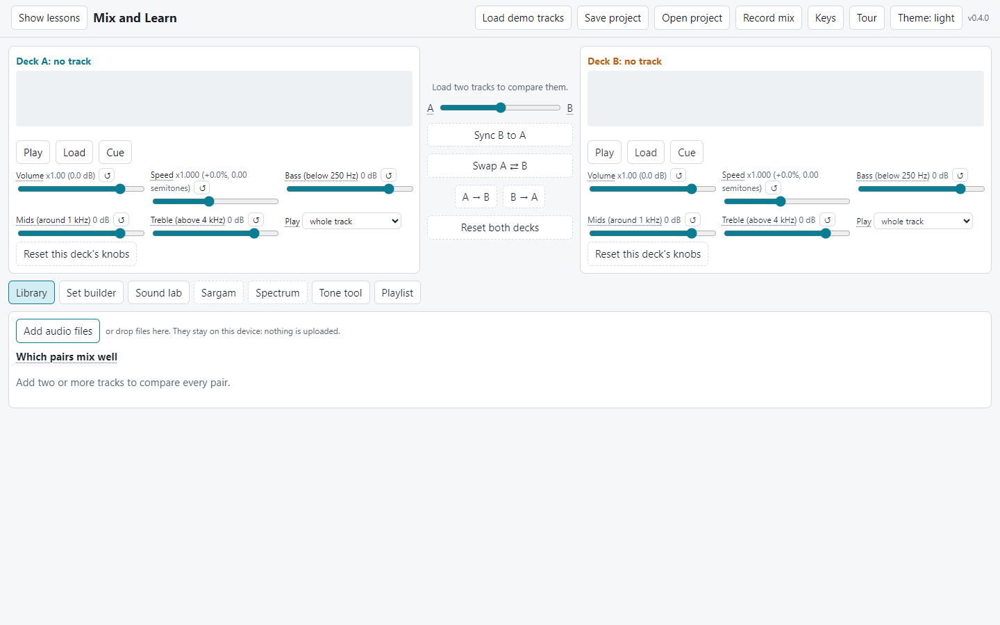
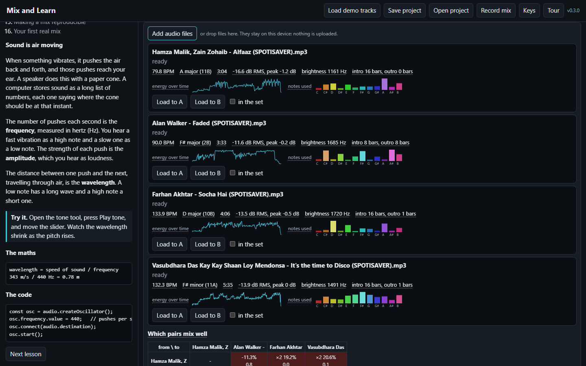
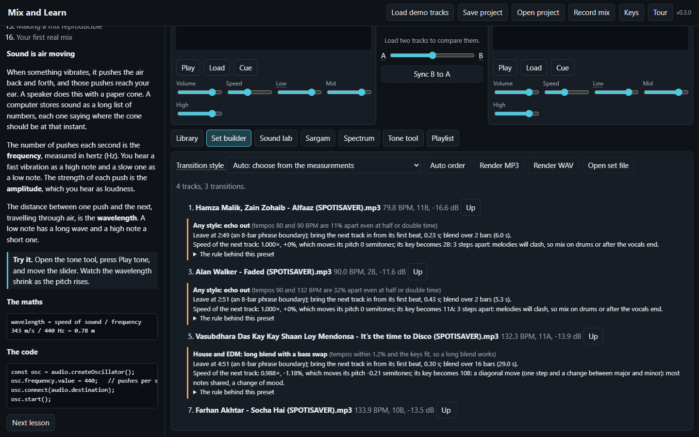
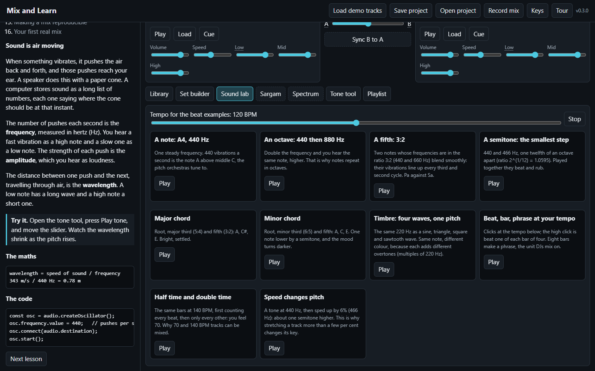
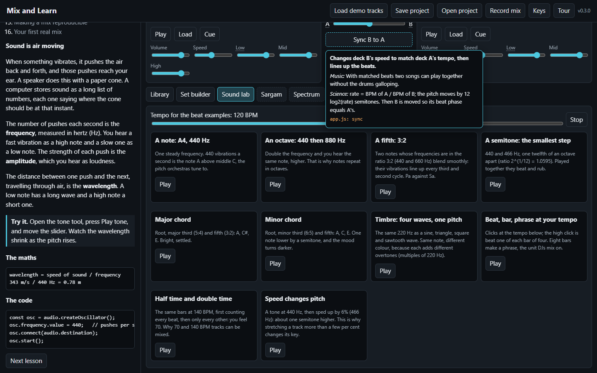
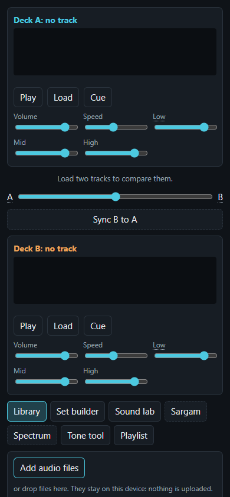

# Mix and Learn

Learn music and DJ mixing by measuring real tracks. One web app, with no build step, that runs in any desktop browser
and, wrapped by Capacitor, as an Android app from the same code.

- **Teaches**: 17 lessons, a Sound lab (note, octave, fifth, chords, timbre, beats and bars, half time), an explanation
  for every control (hover, or press and hold on touch), and a first-run tour.
- **Measures** your own files: tempo, key and Camelot code, loudness, peaks, brightness, intro and outro, energy over
  time, notes used; and how well every pair would mix.
- **Mixes**: plans a set with transition styles from different scenes (house bass swap, pop crossfade, Bollywood cut
  on the sam, acid filter sweep, echo out), explains each decision, renders it as MP3 or WAV with loudness matching,
  and saves a set file with file fingerprints so the same mix can be made again.







| Sound lab | Explanations on hover | Phone width |
|---|---|---|
|  |  |  |

The guide, [Mix and Learn (PDF)](docs/guide/Mix_and_Learn_guide.pdf), covers music from first principles, how the
app measures, how different scenes mix, worked sets, the code, and building the Android app from nothing. Its LaTeX
source is in `docs/guide/tex`.

## Run on a computer

```bash
python dev/serve.py        # opens http://localhost:8765; pages reload by themselves on every change or commit
npm test                   # known-answer tests for measurement and mixing rules (Node)
node tools/plan.mjs --order auto a.mp3 b.mp3 c.mp3   # measure and plan a set from the command line (needs ffmpeg)
```

## Android

```bash
npm install
npx cap sync android       # copy web/ into the Android project
npx cap open android       # build and run in Android Studio, or: cd android && gradlew assembleDebug
```

See the guide's Android chapter for installing Android Studio, enabling USB debugging and signing a release.

## Notes

No audio is included or uploaded: files are read on your device, and project and set files hold only settings and
fingerprints. MP3 encoding uses [lamejs](https://github.com/zhuker/lamejs) (LGPL), in `web/vendor/`.

The original Python desktop mixer is still here: `pip install -r djmixer_requirements.txt` then `python djmixer.py`
(see `djmixer.txt`).

MIT licence.
